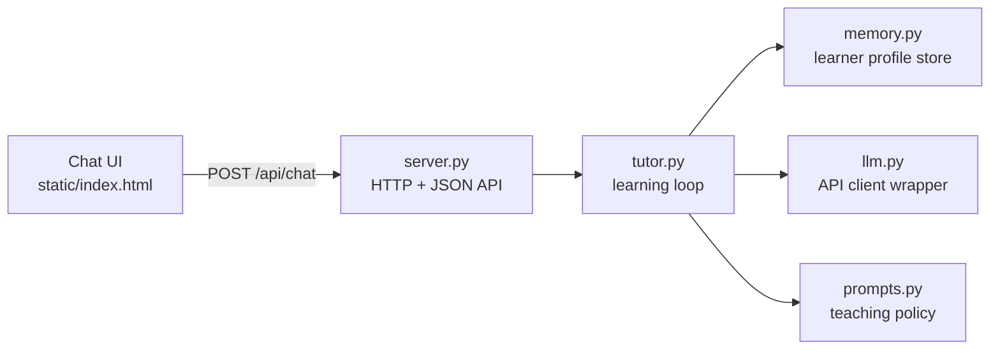
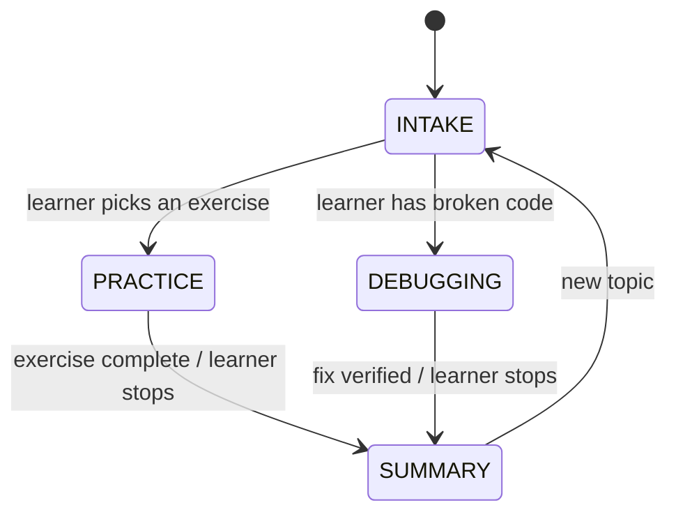

# Design Proposal — Agentic AI Programming Learning Assistant

Project: *Exploration of Agentic AI for Programming Learning Assistance*
Status: prototype proposal, implemented in this repository.

## 1. Minimal Viable Product (MVP)

A single-user chat assistant that helps a beginner Python learner with two
workflows:

1. **Guided practice** — understand an exercise, break it into steps, develop
   an approach, and reflect on the result.
2. **Guided debugging** — collect code, expected behaviour, actual behaviour,
   and error messages; form a hypothesis; choose a debugging step; interpret
   the result; verify a fix.

The assistant uses a Socratic teaching approach. It asks one question or
gives one hint at a time. It escalates hints gradually. It gives a short
explanation with a small example when the learner stays stuck. It does not
give complete solutions by default.

The MVP includes:

- A web chat interface (submit code and error messages, request hints,
  review progress).
- A persistent learner profile (concepts, misconceptions, exercise history,
  goals, preferences), stored as a local JSON file.
- Learner controls to inspect, correct, reset, and delete the profile.
- An LLM integration behind a small client wrapper, with graceful failure
  handling and a mock mode for offline development and testing.
- A session summary at the end of each exercise.

Explicitly out of scope for the MVP:

- Multiple programming languages (Python only).
- Code execution. All code analysis is by inspection. The assistant states
  this clearly and never claims to have run code.
- Multi-agent orchestration. One agent with an explicit learning loop is
  enough at this scale.
- Accounts and multi-user management. One learner profile per data file.

## 2. Technical stack

| Layer | Choice | Reason |
|---|---|---|
| Language | Python 3.11 | Matches the taught language; easy for evaluators to read |
| Interface | Vanilla HTML/CSS/JS chat page | No build step; easy to host and inspect |
| Server | Python standard library (`http.server`) | Zero dependencies; reproducible in any environment |
| LLM integration | OpenAI-compatible Chat Completions API over HTTPS (`urllib`) | Works with OpenAI, Azure OpenAI, and local servers (Ollama, LM Studio) |
| Memory | JSON file per learner (`data/profile.json`) | Human-readable; easy to inspect, correct, reset, delete |
| Tests | Python `unittest` with a scripted mock LLM | Runs without network or credentials |

Rationale: the research questions concern teaching behaviour, not
infrastructure. A zero-dependency stack keeps the prototype reproducible and
keeps evaluation focused on the tutoring logic.

Credentials: the API key is read from the `LLM_API_KEY` environment variable
(or a local `.env` file that is gitignored). No credentials appear in source
code.

## 3. Architecture



Separation of concerns:

- `server.py` — HTTP transport only. No teaching decisions.
- `tutor.py` — the explicit learning loop and session state machine. Decides
  the next pedagogical action. No HTTP or network code.
- `prompts.py` — the Socratic teaching policy as prompt text, assembled from
  session state and profile.
- `memory.py` — profile load/save/merge/reset/delete. No LLM calls.
- `llm.py` — one function: send messages, return text. Retries once, then
  raises a typed error the engine converts into a graceful fallback.

## 4. The learning loop (agentic behaviour)

The engine is a single agent that runs an explicit loop on every learner
message:

1. **Identify goal and difficulty.** Intake phase: ask what the learner wants
   to work on (practice or debugging), capture the exercise or the code, and
   run a short warm-up question to estimate prior understanding.
2. **Choose the next small step.** The engine tracks the current sub-goal
   (e.g. "understand the loop condition"), the hint level, and the attempt
   count for that step.
3. **Act.** Ask one question, give one hint, or suggest one concrete action
   (e.g. "add a print of `i` inside the loop and tell me what you expect").
4. **Evaluate the response.** The LLM classifies the reply (correct
   reasoning, partial, misconception, stuck, off-task) and the engine records
   evidence in the session.
5. **Update the profile and adjust.** Misconceptions and confirmed
   understanding are written to the profile. Hint level escalates only after
   a failed attempt, never automatically.
6. **Summarize.** When the learner finishes (or gives up), the engine
   produces a summary: what was practised, what evidence of understanding
   was seen, what to try next, and one similar practice question.

### State machine



### Stuck policy (rule-based, not left to the LLM)

- Hint levels per step: `conceptual clue → specific guidance → worked
  micro-example → explanation + check question`.
- After 2 consecutive stuck/failed attempts on the same step, the engine
  instructs the LLM to stop asking questions and give a short explanation
  with a small example, followed by one check question.
- Complete solutions require an explicit learner request (`give me the
  solution`) and are always followed by a similar practice question.

### Honesty policy

The system prompt forbids claiming code was executed. The UI footer states:
"This assistant analyses code by inspection. It does not run your code."


## 5. Learner memory structure

`data/profile.json`:

```json
{
  "version": 1,
  "created_at": "2026-10-15T10:00:00Z",
  "goals": ["get comfortable with loops"],
  "preferences": {"explanation_style": "short examples"},
  "concepts": {
    "for_loops": {
      "evidence": [
        {"date": "2026-10-15", "kind": "independent_success",
         "note": "traced a for loop over a list correctly"}
      ],
      "misconceptions": ["range(n) includes n"],
      "hints_used": 3
    }
  },
  "exercises": [
    {"date": "2026-10-15", "topic": "for_loops", "workflow": "practice",
     "outcome": "solved_with_hints", "hints_used": 3}
  ]
}
```

Design rules:

- Understanding is tracked **per concept** through dated evidence entries.
  There is no single ability score.
- Evidence distinguishes `independent_success` from `solved_with_hints`.
- Misconceptions are tentative: repeated correct reasoning removes them;
  one success does not.
- Only learning-relevant data is stored. No raw chat log is kept in the
  profile; the conversation lives only in server memory for the session.
- Learner controls (in the UI and as chat commands): `/profile` (inspect),
  `/correct` (fix an entry), `/reset` (clear progress, keep goals),
  `/delete` (delete the file entirely).

## 6. Beginner concept scope (Python)

variables and types · conditionals · `for`/`while` loops · functions and
return values · lists and indexing · strings · reading tracebacks

The intake prompt steers practice suggestions toward this set.

## 7. Acceptance criteria

A build is acceptable when all of the following hold:

1. **Two workflows.** A learner can complete a guided practice session and a
   guided debugging session end to end in the chat UI.
2. **Socratic behaviour.** In a scripted mock-LLM test and in manual review
   of at least three live sessions, the assistant asks at most one question
   per turn and does not reveal a full solution before the stuck threshold
   or an explicit request.
3. **Stuck handling.** After two stuck turns on one step, the assistant
   switches to explanation + check question (verified by unit test).
4. **Memory.** Evidence, misconceptions, and exercise outcomes appear in
   `profile.json` after a session; `/profile`, `/correct`, `/reset`, and
   `/delete` work.
5. **Adaptation.** The prompt sent to the LLM contains profile-derived
   context (known misconceptions, hint history) — verified by unit test on
   the prompt builder.
6. **Honesty.** No assistant message in mock or live sessions claims to have
   executed code.
7. **Graceful failure.** With the API unreachable, the UI shows a friendly
   message and the session state is preserved (verified by unit test with a
   failing mock client).
8. **Setup.** A new user can start the prototype with only Python 3.11 and
   an API key, following the README, in under 10 minutes.

## 8. Assumptions

- Learners are adults or supervised students testing locally; the prototype
  is not deployed publicly, so no authentication is needed.
- One learner per installation is acceptable for small-scale user testing;
  the profile file path can be pointed at different files per participant.
- The evaluator has access to an OpenAI-compatible API (or a local model
  server). Mock mode covers development without one.
- English-only interaction.

## 9. Open decisions (need stakeholder input)

1. **Model choice for evaluation** — a hosted frontier model vs. a local
   model affects guidance quality and privacy. Default: configurable via
   env vars; evaluation should fix one model for comparability.
2. **Exercise corpus** — ship 5–8 seeded beginner exercises, or let learners
   bring their own? Default: bring-your-own plus three built-in starters.
3. **Session persistence across restarts** — currently the conversation is
   in-memory only; only the profile persists. Add session logs if the study
   needs verbatim transcripts (with participant consent).
4. **Study ethics** — consent wording and data handling for user testing are
   the researcher's responsibility; the delete-profile control supports
   withdrawal.
